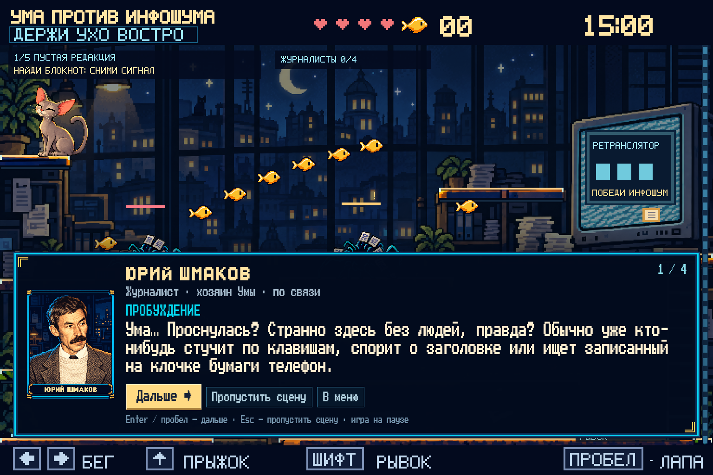
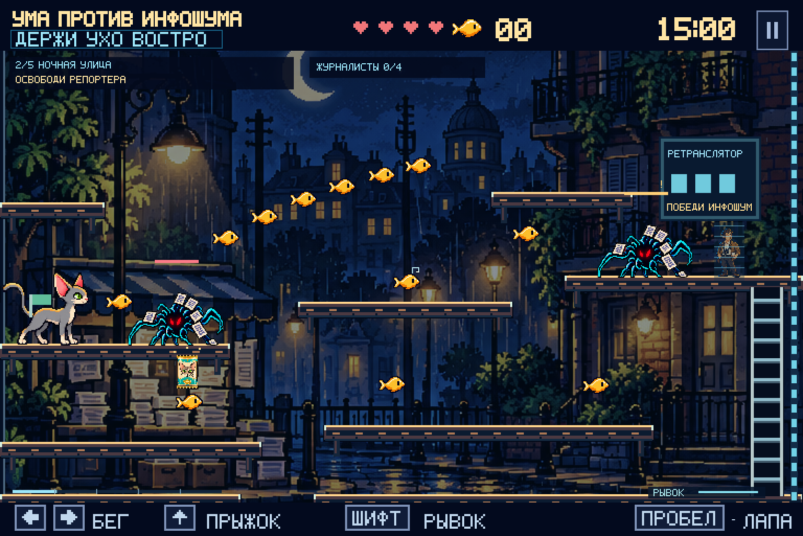
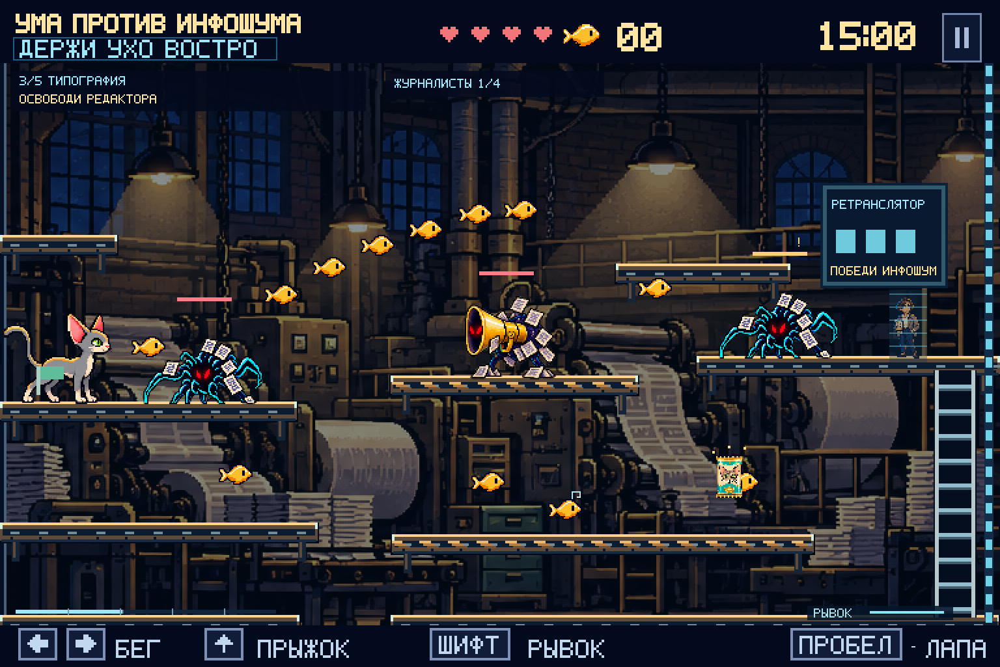
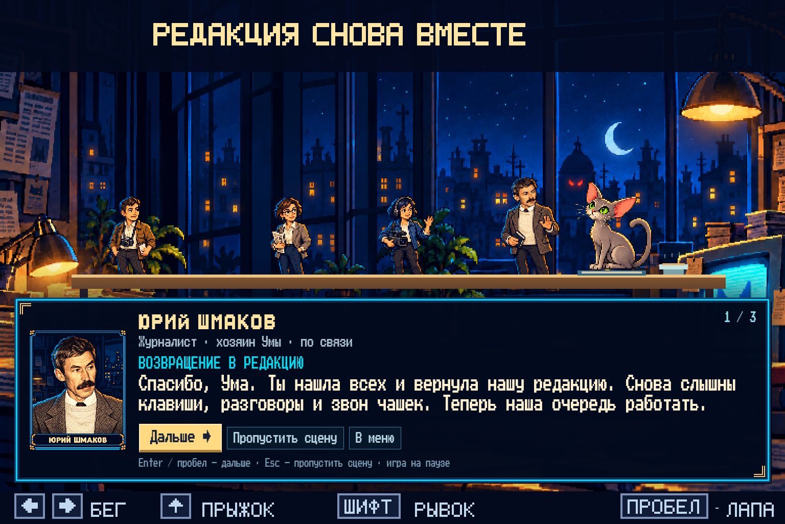

# УМА ПРОТИВ ИНФОШУМА

**держи ухо востро**

Пиксельная браузерная игра про серую ориентальную кошку Уму,
пропавших журналистов и ожившие новости.

**[Играть — версия 0.6.0](https://artemsmakov1997-debug.github.io/umagame/?v=0.6.0)**



## История и рассказчик

Ума просыпается в пустой редакции. Журналисты, которые раньше сдерживали
инфошум и кликбейт, исчезли. Их след ведёт через ночную улицу, типографию
и телестудию к башне эфира.

Журналист **Юрий Шмаков**, хозяин Умы, поддерживает её по старой редакционной
связи. Использован согласованный первый портрет, без последующей мультяшной
перерисовки. Реплики представлены **текстовыми диалогами**; записи голоса нет.
Полный игровой сценарий — [docs/STORY.md](docs/STORY.md), источник текста — `story.js`.

При выборе «Начать игру» Ума просыпается на верхней полке редакции, открывает
глаза и прислушивается к приёмнику. После вступления управление переходит
игроку. Юрий знакомит с каждым монстром при первой встрече, помогает по пути
и рассказывает о спасённых коллегах.

Во время диалогов полностью остановлены физика, противники, снаряды, таймер,
перезарядки и усиление супчиком. Enter / пробел или «Дальше» перелистывают
реплики. Esc / «Пропустить сцену» закрывают текущую сцену. На телефоне диалог
располагается под игровым экраном и может прокручиваться вместе со страницей.
После чтения управление возвращается Уме. Нажатие для продолжения разговора
не превращается в случайный удар.

## Пять глав

| Глава | Локация и задача | Новая угроза |
| --- | --- | --- |
| 1 | **Пустая редакция** — найти блокнот с адресом репортёра | Инфошум |
| 2 | **Ночная улица** — освободить репортёра у газетного киоска | Кликбейт |
| 3 | **Типография** — найти редактора; движущиеся ленты влияют на движение Умы | Громкий заголовок |
| 4 | **Телестудия** — освободить съёмочную группу | Паникёр |
| 5 | **Башня эфира** — найти Юрия и остановить большой монитор | Источник шума |

У локаций разные фон, палитра, расположение платформ и атмосферные детали:
дождь на улице, тёплый свет печатного цеха, прожекторы студии, огни башни.
Фон приглушён; все реальные поверхности выделены светлой верхней гранью.
Подсветка и коллизии используют одну геометрию. Лестницы заметны отдельно.




Первые четыре главы заканчиваются защищённым ретранслятором. Победите
Инфошум с золотой меткой и трижды ударьте устройство. Первый сигнал открывает
доступ к блокноту, следующие освобождают коллег и открывают дальнейший путь.
Цель главы и число спасённых видны сверху. При переходе в новую главу
сохраняется чекпоинт и восстанавливается одно сердечко.

Новые виды противников появляются постепенно. Незнакомый монстр не атакует,
пока Юрий не представит его; противники других глав ждут прибытия Умы.
В финале сочетаются уже знакомые угрозы.

## Монстры и библиотека

В библиотеке ровно пять согласованных монстров, без категорий под именами.
Крупный анимированный портрет, описание, две способности и рамка с тактикой
расположены по утверждённому макету. Карточки доступны мышью, клавиатурой
и касаниями. Данные собраны в `catalog.js`.

| Монстр | Поведение |
| --- | --- |
| **Инфошум** | Предупреждает и бросает новостные листки. Их можно отбивать лапой. |
| **Кликбейт** | Притворяется золотой рыбкой с крючком. При приближении раскрывается и поглощает Уму; ранний удар и рывок помогают избежать захвата. |
| **Громкий заголовок** | За 0,8 секунды показывает направление, затем отбрасывает по прямой перед рупором. Сама волна не отнимает здоровье. |
| **Паникёр** | Поднимает звон и привлекает до четырёх ближайших противников. |
| **Источник шума** | Выбирается из большого монитора. Сохранён прототип боя с двумя фазами, залпом, волной, бумажным дождём и призывом помощников. |

У всех монстров отдельные позы шагов, подготовки и атаки, выбранные по их
фактическому состоянию. У рупора и Паникёра есть медленное патрулирование.
Ума в меню моргает, облизывается и умывается; все позы закреплены по опорной
лапе и используют постоянный масштаб.

## Коллеги и финал

Спасённые журналисты помогают в бою:

- Репортёр отвлекает часть помех: при призыве выходит один помощник вместо двух.
- Редактор на 0,45 секунды продлевает открытие панели для удара.
- Съёмочная группа один раз возвращает сердечко при переходе босса во вторую фазу.

После победы освобождается Юрий. Ума и коллеги возвращаются в редакцию;
рассказ завершается сценой у общего стола, блокнотом и миской супчика.
Только после заключительных реплик появляется итог партии.



## Меню и управление

В главном меню: **Начать игру**, **Библиотека**, **Авторы**, **МЕДИА.СТРАЖ**.
Слово «СТРАЖ» выделено голубым; ссылка открывается в новой вкладке.

- `←` / `→` или `A` / `D` — бег.
- `↑` / `W` — прыжок, у лестницы — подъём.
- `↓` / `S` — спуск по лестнице.
- `Пробел` / `X` — лапа. Можно коротко нажать или удерживать.
- `Shift` — рывок с перезарядкой 1,5 секунды.
- `Esc` / `P` / кнопка `Ⅱ` — пауза; из неё можно вернуться в меню.
- В меню и библиотеке `↑` / `↓` — выбрать, `Enter` — открыть, `Esc` — назад.
- На телефоне доступны кнопки бега, прыжка, спуска, лапы и рывка.

У Умы четыре сердечка. Восемь рыбок восстанавливают одно. Падение в разрыв
снимает сердечко и возвращает к чекпоинту. «Супер-мур» — прямоугольный пакетик
с мордочкой кошки: восстанавливает сердечко и на 10 секунд усиливает лапу
(+1 урон и +50% дальности). Пакетики находятся на нижних маршрутах.

Партия рассчитана на 15 минут игрового времени; чтение диалогов время не тратит.
Повтор с чекпоинта сохраняет освобождённых коллег, блокнот, открытые проходы,
собранные предметы и уже просмотренные знакомства с монстрами. Местные
противники и бой с боссом начинаются заново. При необходимости даётся не менее
трёх минут. При уходе с вкладки игра ставится на паузу.

«Начать игру» и перезагрузка страницы начинают новую историю. Сохранений между
сессиями пока нет. Звук эффектов включается отдельно; он не обязателен для игры.

## Запуск и проверки

Игра работает без сборки и серверной логики. Нужен обычный HTTP-сервер:

```sh
python3 -m http.server 8000
```

Откройте http://localhost:8000. Альтернатива — `npm start`.
Все изображения и шрифты локальные. При ошибке загрузки есть кнопка повтора.

Для 47 проверок логики нужен Node.js 22+, зависимости не требуются:

```sh
npm test
```

Проверки охватывают боевую механику, физику, пять глав, конвейеры, сюжетную
паузу, порядок монстров, спасение и сохранение коллег, помощь в бою,
вступление и эпилог. Проверочное прохождение подтверждает проходимость
всех пяти глав и победу над обеими фазами босса без принудительной неуязвимости.

Браузерная проверка:

```sh
npm ci
npx playwright install chromium
# При запущенном HTTP-сервере:
npm run test:browser
```

`tests/browser.cjs` отдельно проверяет меню, библиотеку и боевые сценарии.
`tests/story-browser.cjs` проходит реальный сюжетный интерфейс от пробуждения
до возвращения в редакцию: блокировка ввода, перелистывание, короткое нажатие
лапы, блокнот, спасение, финал, повтор и сенсорные диалоги 320/390 пикселей.

Можно задать `GAME_URL`, `BROWSER_PATH` и `UMA_ARTIFACTS`. По умолчанию это
localhost:8000, Chromium Playwright и `/tmp/uma-browser`. GitHub Actions
запускает обе группы проверок и сохраняет скриншоты как `browser-screenshots`.
На реальных телефонах и в других браузерах ещё полезна проверка баланса.

## Файлы

| Файл | Назначение |
| --- | --- |
| `story.js` | Все реплики Юрия, вступление, знакомства и финал |
| `dialogue-ui.js` | Доступное окно рассказчика, клавиши, касания и фокус |
| `level.js` | Пять локаций, поверхности, ленты, персонажи и противники |
| `engine.js` | Физика, пауза диалогов, прогресс, спасение и чекпоинты |
| `boss.js`, `enemies.js` | Атаки и помощь спасённых коллег |
| `campaign-art.js`, `render.js` | Фоны, платформы, журналисты, пробуждение, эпилог и HUD |
| `screens.js`, `index.html`, `style.css` | Меню, библиотека, авторы и адаптивная оболочка |
| `art.js`, `menu-animation.js`, `monster-animation.js` | Общая графика и кадры анимации |
| `assets.js`, `assets/` | Локальные рисунки, портрет и загрузка |
| `game.js` | Цикл, ввод, эффекты и переходы |

Мир — 3840×480 логических пикселей; экран — 768×480 и нижняя полоса управления.
Press Start 2P — CodeMan38, SIL OFL; UmaText — его сжатый вариант под новым
именем, UmaDisplay — собственный жирный алфавит. Лицензия и скрипт сборки
шрифтов находятся в проекте; для запуска игры собирать их не нужно.

GitHub Pages публикует `main` / `/(root)`. Версия ресурсов `0.6.0` предотвращает
смешивание обновлённых модулей со старыми.
