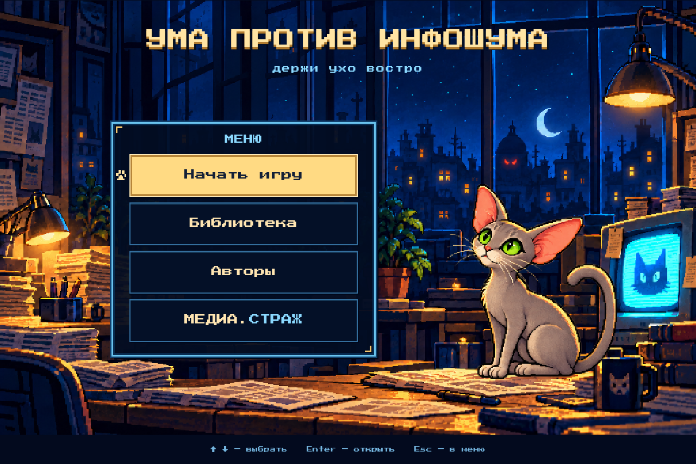
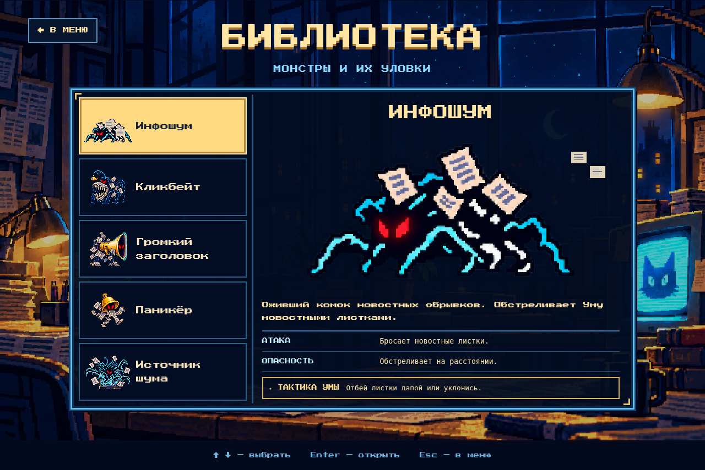
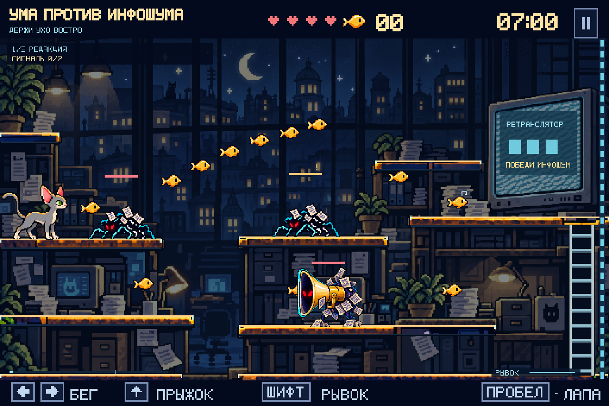

# УМА ПРОТИВ ИНФОШУМА

**держи ухо востро**

Пиксельная браузерная игра про серую ориентальную кошку Уму и ожившие новости.

**[Играть](https://artemsmakov1997-debug.github.io/umagame/?v=0.4.0)**



## Меню и живая Ума

При открытии появляется главное меню с четырьмя пунктами:

- **Начать игру** — новая партия.
- **Библиотека** — все пять монстров, их описание, способности и подсказки.
- **Авторы** — автор проекта, Ума и сведения о создании игры.
- **МЕДИА.СТРАЖ** — сайт проекта в отдельной вкладке; «СТРАЖ» выделено голубым.

Ума в меню — отдельный прозрачный спрайтовый атлас из шести кадров. Она моргает,
облизывает нос, лижет лапу и умывается. Паузы между движениями заданы в
`menu-animation.js`; полный цикл занимает 18 секунд. Это не статичная картинка
с анимацией положения. Ума остаётся однотонной серой и в меню, и в игре.

Меню и карточки — настоящие HTML-кнопки и тексты поверх отдельного фонового
рисунка, поэтому работают мышь, клавиатура и касания. Вверх/вниз выбирают пункт,
Enter открывает, Esc возвращает в меню. В мобильном варианте кнопки крупнее;
сенсорное управление остаётся доступным и при подключённой мыши.

## Библиотека



В библиотеке ровно пять согласованных монстров. Категорий и подзаголовков под
их именами нет. Данные карточек собраны в одном файле `catalog.js`.

| Монстр | Поведение в игре |
| --- | --- |
| **Инфошум** | Предупреждает о выстреле и бросает в Уму новостные листки. Их можно отбивать лапой. |
| **Кликбейт** | Маскируется под золотую рыбку с крючком. При приближении раскрывается и пытается поглотить Уму целиком. |
| **Громкий заголовок** | Показывает направление за 0,8 секунды, затем отбрасывает по прямой линии перед рупором. |
| **Паникёр** | При приближении Умы поднимает звон и привлекает до четырёх ближайших противников. |
| **Источник шума** | Финальный монстр из большого монитора. В карточке его тактика оставлена для будущего согласования. |

Во время поглощения Кликбейтом Ума визуально исчезает в пасти, управление
ненадолго блокируется. Затем теряется одно сердечко и Ума возвращается к
чекпоинту. Приманка не увеличивает счётчик рыбок. Ранние удары лапой и вовремя
сделанный рывок позволяют избежать захвата.

Звуковой толчок рупора сам по себе не отнимает здоровье: опасность — соскользнуть
со стола. Направление фиксируется перед атакой; можно перепрыгнуть линию или
зайти за спину. Звон Паникёра сопровождается видимыми сигналами: соседние враги
поворачиваются к Уме и активнее преследуют/обстреливают её в пределах своих
платформ. Звук для понимания предупреждений не обязателен.

У Источника шума пока сохранён прежний прототип боя: две фазы, залп, волна,
бумажный дождь и призыв помощников. Призываемые помощники теперь тоже Инфошум;
одновременно их не более трёх. Окончательную тактику босса предстоит определить.

## Платформы и карта



Сохранены три зоны: редакция, архив и эфирная. Камера следует за Умой.
Фон приглушён и менее насыщен, а доступные столешницы рисуются отдельным
ярким слоем: светлая верхняя грань, заметные края и тёмная подложка.
Лестницы также выделены. Подсвечены именно поверхности с действующей коллизией.

Первые две зоны заканчиваются ретранслятором. Победите Инфошум с золотой
меткой, затем трижды ударьте ретранслятор — проход дальше откроется.
Время партии — семь минут. Первое прибытие в следующую зону сохраняет
чекпоинт и восстанавливает одно сердечко.

## Пакетик супчика

**«Супер-мур»** — прямоугольный запаянный пакет с кошачьей мордочкой.
Один спрятан на нижнем маршруте архива, второй — в эфирной перед боссом.
При подборе он восстанавливает одно сердечко и на 10 секунд даёт лапе
дополнительную единицу урона и на 50% больше дальности. На экране виден таймер.
Повторный пакет обновляет время, а усиление не складывается.

## Управление

- `←` / `→` или `A` / `D` — бег.
- `↑` / `W` — прыжок; у лестницы — подъём.
- `↓` / `S` — спуск.
- `Пробел` / `X` — лапа; можно удерживать для повторных взмахов.
- `Shift` — короткий рывок; перезарядка 1,5 секунды.
- `Esc` / `P` / кнопка `Ⅱ` — пауза. Из паузы можно вернуться в меню.
- На телефоне — экранные кнопки; для игры удобнее горизонтальная ориентация.

У Умы четыре сердечка. Восемь рыбок восстанавливают одно. Падение в разрыв
нижнего маршрута снимает сердечко и возвращает к чекпоинту. После поражения
со второй зоны можно повторить с чекпоинта; местные противники и бой с боссом
сбрасываются, а снятые сигналы и собранные предметы сохраняются в текущей партии.
Если осталось меньше двух минут, повторная попытка даёт две минуты.

Меню, библиотека и пауза не тратят игровое время. При уходе с вкладки игра
автоматически приостанавливается. «Начать игру» в главном меню и обновление
страницы начинают новую партию; сохранений между сессиями пока нет.

## Запуск

Игра не требует сборки, установки пакетов, ключей или серверной логики.
Нужен обычный HTTP-сервер, например Python 3:

```sh
python3 -m http.server 8000
```

Откройте http://localhost:8000. Альтернатива: `npm start`.
`file://` не подходит для JavaScript-модулей. Все изображения и шрифт локальные.
При ошибке загрузки доступна кнопка повтора.

## Проверки

Node.js 22+; для 30 проверок игровой логики зависимости не нужны:

```sh
npm test
```

Проверяются состав каталога, последовательность кадров Умы, прохождение трёх
зон, затворы, все новые атаки, поглощение и возрождение, направление звукового
толчка, тревога, усиление супчиком, пауза, отражение листков и бой с боссом.
Проверочное прохождение подтверждает победу над обеими фазами босса без
принудительной неуязвимости.

Для браузерных проверок в Chromium:

```sh
npm ci
npx playwright install chromium
```

Запустите статический сервер и в другом терминале:

```sh
npm run test:browser
```

Можно указать `GAME_URL`, `BROWSER_PATH` (системный Chromium) и `UMA_ARTIFACTS`
(каталог скриншотов). По умолчанию это localhost:8000, браузер Playwright
и `/tmp/uma-browser`. Проверки охватывают меню, пять разных кадров анимации,
библиотеку, авторов, ссылку проекта, бой, чекпоинты, звук, сенсорный ввод,
экраны 320/390 пикселей и восстановление после частичной ошибки загрузки.

GitHub Actions запускает и логику, и браузерные проверки. Скриншоты проверки
сохраняются как артефакт `browser-screenshots`. На реальных телефонах и в других
браузерах ещё нужна отдельная проверка управления и баланса.

## Основные файлы

| Файл | Назначение |
| --- | --- |
| `screens.js`, `index.html`, `style.css` | Главное меню, библиотека, авторы и адаптивная оболочка |
| `catalog.js` | Согласованные имена, описания и способности пяти монстров |
| `menu-animation.js`, `art.js` | Кадры живой Умы и общие функции рисования портретов |
| `level.js` | Карта, платформы, исходные враги, рыбки и супчик |
| `enemies.js` | Стрельба Инфошума, Кликбейт, рупор и тревога Паникёра |
| `engine.js`, `boss.js` | Физика, здоровье, предметы, чекпоинты и прототип босса |
| `render.js` | Приглушённое окружение, выделенные платформы, спрайты и эффекты |
| `assets.js`, `assets/` | Изображения, координаты атласов и загрузка с обработкой ошибок |
| `game.js` | Игровой цикл, ввод, звук и переходы между экранами |

Карта — 2304×480 логических пикселей; игровой экран — 768×480 и полоса
управления 768×32. Изображения подготовлены по согласованным макетам.
Шрифт **Press Start 2P** — CodeMan38, **SIL Open Font License 1.1**;
лицензия сохранена в `assets/fonts/OFL.txt`.

Сайт публикуется GitHub Pages из `main` / `/(root)`. У модулей, стилей и рисунков
стоит версия `0.4.0`, чтобы браузер не смешивал обновление со старыми файлами.
