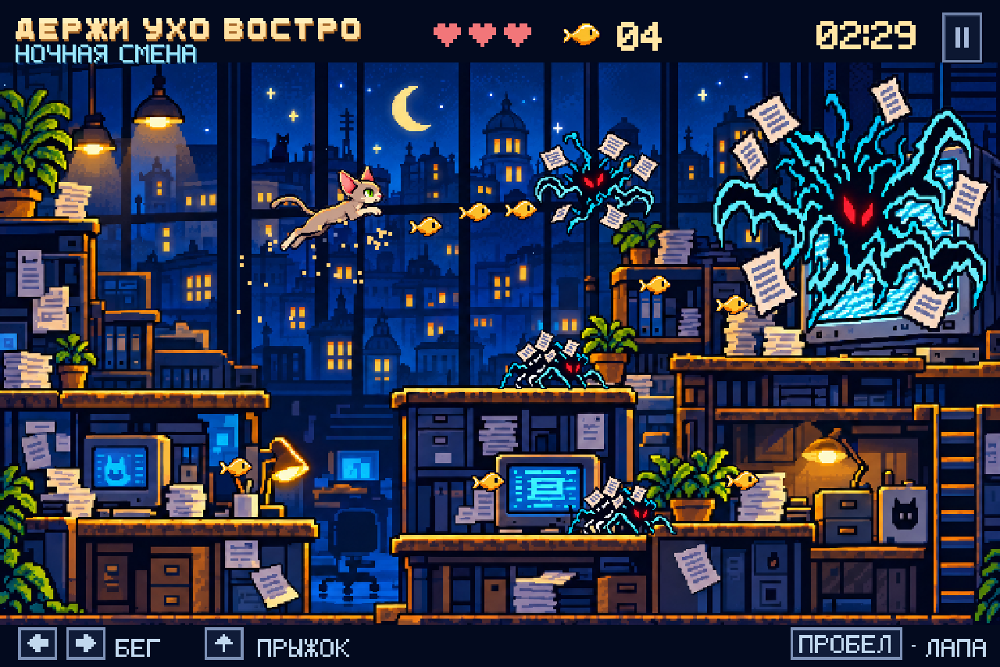

# Держи ухо востро · Ночная смена

Пиксельная браузерная аркада про ориентальную кошку Уму, ночную редакцию
и оживший информационный шум.

**[Играть в браузере](https://artemsmakov1997-debug.github.io/umagame/)**



## Графика 0.2

Сцена переработана по согласованному макету: насыщенный синий город за окнами,
тёплый свет ламп, фактурная мебель, крупный заражённый монитор, золотые рыбки
и бумажные помехи. Убран внешний заголовок приложения; название, жизни, рыбки
и таймер расположены внутри игрового экрана. Для названия нарисован жирный
пиксельный алфавит.

Окружение, Ума и помехи — отдельные изображения. У Умы есть позы покоя, два
шага бега, прыжок и удар. Рыбки собираются, помехи двигаются и исчезают после
удара, монитор выпускает бумажные снаряды. Полное изображение из макета не
подставляется вместо работающей игры.

Один подробный экран редакции с верхним маршрутом, нижними столами и лестницей.
Границы платформ привязаны к столешницам на рисунке. Лестница справа позволяет
вернуться к монитору с нижнего этажа. Логическое разрешение игры — 768×480,
нижней полосы управления — 768×32; общая композиция сохраняет пропорции 3:2
макета. Масштабирование изображений без сглаживания.

## Играть локально

Нужен Python 3 и современный браузер:

```sh
python3 -m http.server 8000
```

Откройте http://localhost:8000. Альтернатива: `npm start`.
Установка пакетов, сборка, ключи и серверная часть не нужны.
Не открывайте `index.html` через `file://`: браузер блокирует JavaScript-модули.

## Управление и правила

- `←` / `→` или `A` / `D` — бежать.
- `↑` или `W` — прыгнуть; у правой лестницы — подниматься.
- `↓` или `S` — спускаться по лестнице.
- `Пробел` или `X` — удар лапой; можно удерживать.
- `Esc` / `P` или кнопка `Ⅱ` — пауза.
- На сенсорном экране — кнопки движения, спуска, удара и прыжка.
  Удобнее играть горизонтально.
- Звук включается отдельно и по умолчанию выключен.

За 2 минуты 30 секунд доберитесь до источника шума справа. Рыбки —
необязательная цель для исследования редакции. Помех можно ударить лапой
или прыгнуть на них сверху. После урона действует короткая неуязвимость.
На среднем верхнем столе — чекпоинт. Падение в разрыв между нижними полками
отнимает жизнь и возвращает к чекпоинту или началу.

Ударьте заражённый монитор пять раз, отбиваясь от его снарядов. У Умы три жизни.
После победы или поражения можно сразу начать новую смену. При уходе с вкладки
игра автоматически ставится на паузу. Если рисунки не загрузились, показывается
сообщение с кнопкой повторной загрузки.

## Устройство проекта

| Файл | Назначение |
| --- | --- |
| `index.html`, `style.css` | Стартовый экран, пауза, результаты и адаптивная оболочка |
| `assets/newsroom.png` | Окружение по утверждённому визуальному референсу |
| `assets/uma.png` | Атлас поз Умы с прозрачностью |
| `assets/noise.png` | Помехи, монстр и рыбка с прозрачностью |
| `assets.js` | Загрузка рисунков и координаты спрайтов в атласах |
| `engine.js` | Физика, геометрия столов и лестницы, противники, сбор рыбок |
| `render.js` | Отрисовка сцены, спрайтов, эффектов и HUD |
| `pixel.js` | Два локальных растровых алфавита и пиксельные значки |
| `game.js` | Игровой цикл, ввод, звук и переходы между экранами |
| `tests/engine.test.js` | Проверки логики и полного прохождения |

Рисунки подготовлены из визуального референса игры. Все ресурсы локальные.
Внешних шрифтов, аналитики, трекеров и обращений к сервисам во время игры нет.

## Проверка

Нужен Node.js 22 или новее:

```sh
npm test
```

12 проверок: приземление и прыжок, пауза, чекпоинт и возрождение,
сбор рыбок, удар лапой, прыжок на врага, неуязвимость и перезапуск,
финальный монитор, таймер, полное прохождение верхнего маршрута,
лестница в обе стороны и буфер прыжка перед приземлением.
GitHub Actions запускает проверки при push и pull request.

Дополнительно версия проверена в Chromium с загруженными изображениями:
движение, прыжок и удар с клавиатуры, пауза/продолжение, автоматическая пауза,
звук, экран 390×844, реальное сенсорное движение и ошибка загрузки рисунков.
На реальных телефонах и в других браузерах отдельная проверка ещё нужна.

## GitHub Pages

Сайт публикуется из ветки `main`, папки `/(root)`. После push дождитесь
завершения `pages build and deployment` в Actions. Если после обновления видна
старая версия, обновите страницу с очисткой кэша.

Для нового размещения: **Settings → Pages → Deploy from a branch → main → /(root)**.
Файл `.nojekyll` отключает обработку Jekyll.

## Дальнейшая разработка

Пока это один уровень без сохранений, таблицы рекордов и интеграции с
анализатором МЕДИА.СТРАЖ. Следующий этап — настройка сложности, дополнительные
анимации и большее разнообразие поведения бумажных помех.
