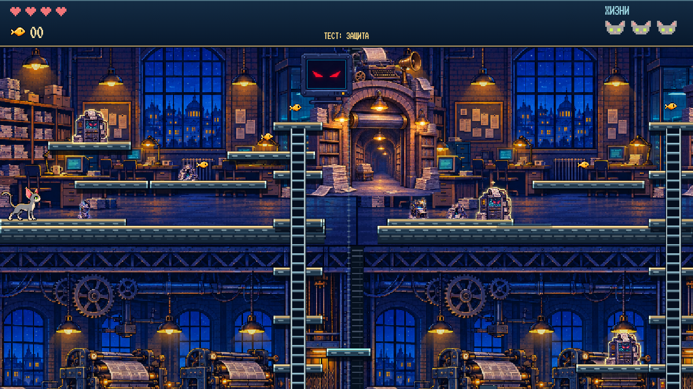
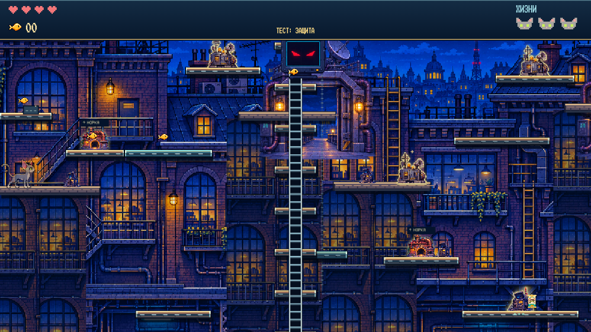
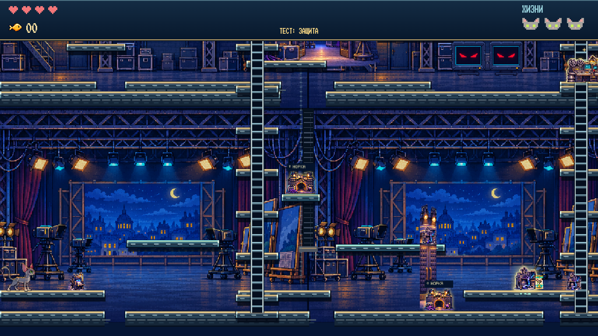
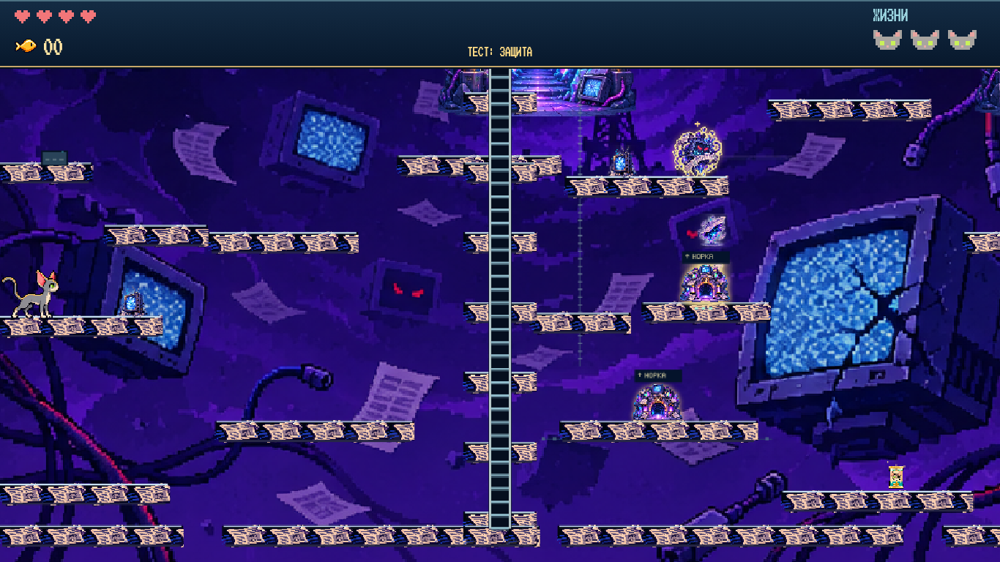

# Интерактивный мир 0.22.0 — отчёт

Основа: актуальный `main`, `1be6e01fb2564ed2256dd48fda6cc153cac612f9`, с завершённым первым ТЗ. Новая ветка: `codex/interactive-world-v0-22-0`. Работы разделены на девять последовательных этапов. Внешние репозитории и сайт МЕДИА.СТРАЖ не менялись.

**Тестовая неуязвимость оставлена включённой при запуске.** Сохранены четыре главы, все 12 обычных монстров, четыре босса, привычные действия Умы, расследование, сюжетные переходы, постановки поражения и заключительный экран предыдущего обновления.

## 1. Карты

Все восемь основных карт и арен имеют собственные планы в общей системе координат высотой 1056. Основные главы шириной 2304, арены — 1536. Камера плавно следует по X/Y; переходы между этажами не загружаются. У редакции и студии два настоящих этажа с перекрытиями, стенами, лестницами и лифтами. Крыши состоят из разных вертикальных маршрутов и фасадов; измерение — из слоёв разорванных островов.

Постоянные лестницы и площадки гарантируют прохождение без временной способности врага. Проёмы лифтов согласованы с коллизиями, мониторы не блокируют прыжок. Все 17 антенн проверены физическим тестовым пилотом без телепортации Умы. Дальние Фейкньюс и Вброс действительно переходят между участками, включая обход перегородки через верхний маршрут.

| Редакция | Крыши |
| --- | --- |
|  |  |

| Студия | Измерение |
| --- | --- |
|  |  |

Это исходные скриншоты Chromium 1366×768 без монтажа. Браузерные проверки дополнительно снимают верх/низ всех восьми карт и арен в пяти требуемых размерах; полный набор сохраняется артефактом GitHub Actions.

## 2. Монстры и полезные способности

- Фейкньюс получает видимую «Сенсацию» около печати; отключение источника снимает ускорение.
- Копир проходит четыре читаемые стадии, держит одного двойника и создаёт бумажную Уму, отвлекающую соседей. Лоток можно прервать; все порождения исчезают с хозяином.
- Цензор замедляет обе стороны и временно запирает приборы/проходы. Лапа очищает печать, рывок обходит преграду.
- Информатор заранее отмечает посадку; удар по метке или приёмнику перенаправляет её в другое свободное место. Появление внутри Умы исключено.
- Раздуватель толкает, ускоряет врагов, отклоняет снаряды и поднимает Уму вертикальным потоком. Передний полупузырь и уязвимая спина сохранены.
- Паникёр усиливает соседей и имеет конечный запас трёх призывов. Звон прерывается скрытностью, лапой, чернилами или передатчиком.
- Вброс чередует опасный заголовок и безопасную подвижную бирюзовую строку, на которой можно ехать.
- Нарезчик открывает отмеченные перегородки после предупреждения; обязательный обход остаётся.
- Склейка сохраняет захват и дополнительно создаёт временный мост, связывая соседа.
- Эхо записывает две секунды движения; один предупреждённый призрак повторяет путь и рассеивается лапой/рывком.
- Кликбейт раскрывается от удара по приманке, временно теряет захват. Рывок освобождает даже из начавшегося захвата.
- Помеха искажает только фон: Ума, края платформ, приборы и предупреждения остаются читаемыми. Удар убирает рябь на три секунды.

Обычный захват Эха/Кликбейта снимает сердце; полная жизнь теряется при исчерпании здоровья. Эхо также переносит на безопасную посещённую опору. Падение сохраняет прежнюю потерю полной жизни. В тестовом режиме защита работает как раньше.

Подробные состояния, ограничения и контрприёмы: [MONSTERS.md](MONSTERS.md). Библиотека и двухстраничные подсказки обновлены под новые правила.

## 3. Устройства и события

В каждой основной главе есть видимый конечный источник: принтер, приёмник, катушка или разлом. Его можно отключить; три появления за прохождение, один собственный живой монстр одновременно. Арены имеют вспомогательные прессы/передатчики/пульты/якоря. Лапа и отражённый снаряд заклинивают устройство и временно раскрывают ядро. Связанные конвейеры, ветер или декорации действительно меняются.

Каждая глава получила событие на 26 секунд: бумажная погоня, перегрузка крыш с предупреждёнными разрядами, перестановка студийных декораций, личный призрак Умы. Внутри главы события однократные, пауза останавливает их время. Возрождение сохраняет отключённые приборы и потраченные бюджеты. «Повторить локацию» восстанавливает только местные устройства, перегородки, источники и событие, сохраняя прошлые главы и рыбки. Лифты после остановки пультом возобновляют движение без скачка позиции.

## 4. Боссы

У каждого собственная архитектура и три фазы с новыми задачами:

| Босс | Изменение арены и задача |
| --- | --- |
| Распространитель | Двухэтажный цех: газетный дождь → конвейеры, копии и чернила → реверс конвейеров, пикирование, ядро. Газета, отражённая в пресс, останавливает оборудование. |
| Агитатор | Разнесённые крыши: вещание → дополнительные воздушные потоки → перегрузки передатчиков и окна атаки. Лапа или отражённый пакет открывают защиту. |
| Манипулятор | Павильон с верхней пультовой: рамки и строки → разрезы и ленты-мосты → подвижная сцена с меняющимися высотами. Пульт останавливает местную конструкцию. |
| Инфошум | Слои островов: волны → знакомые приёмы прошлых глав → перестройка островов и до двух временных разломов, открывающих путь к ядру. |

Запас помощников ограничен восемью на бой. Старые атаки очищаются при переходе фазы, постановка поражения защищает Уму. В третьей фазе перегрузка периодически открывает ядро даже без точного попадания в устройство; взаимодействие с прибором продлевает окно. Это запасной путь для игрока, а не обязательный единственный приём.

## 5. Юрий

[Лист портретов 1774×887](../assets/yuri-emotions.png): спокойный, задумчивый, удивлённый, встревоженный, испуганный, искажённый; седьмая колонка — поддельная улыбка для заражённого экрана студии. У всех один персонаж с прежними волосами, усами и одеждой. Три ряда — покой, моргание, речь. Портреты работают и в монологах, и на устройствах мира; сбой/восстановление зависят от качества связи, а время анимации останавливается на паузе.

## 6. Цепочка сообщений

[Новая иллюстрация 1536×1024](../assets/chain-reaction.png) показывает обычных людей, телефоны, ноутбуки, телевизор, газеты и разные пересылки. Центрального оратора с громкоговорителем нет. Она используется после Агитатора и в сцене массового распространения финальной перемотки. Причина появления существ по-прежнему раскрывается только в финале; последним иллюстрированным кадром остаётся объятие Юрия и Умы.

## 7. Проверки

- `npm test`: **222 логические проверки**, без ошибок. Включены достижимость всех 17 антенн обычными командами, дальнее преследование, новые взаимодействия, три фазы, события, ограничения порождений, пауза, возрождение/повтор, защита, портреты и сохранённый сценарий.
- `npm run test:browser`: 16 сценариев, включая новый `architecture-browser.cjs`; полный итоговый результат отмечается в PR и статусе Actions.
- Целевые размеры: **1920×1080, 1366×768, 390×844, 320×568, 844×390**. Дополнительно сохранены прежние размеры из регрессии. Проверены изображения обоих этажей, управление, HUD, библиотека, сюжетные сцены и ошибки JavaScript.
- Все корневые JS-модули и браузерные сценарии проходят `node --check`; `git diff --check` не находит ошибок форматирования.
- На прогретом системном Chromium модель + Canvas сцены с 24 снарядами и двумя временными разломами: медиана **2,5 мс**, 95-й процентиль **4,1 мс** за кадр на данном окружении. Это не измерение FPS реального телефона. В CI замер повторяется и печатается в лог без хрупкого порога времени.
- Длительность дождя и высота появления Эха у босса учитывают полный новый размер арены; скорости и области столкновения сохранены.
- Нарисованные фоны кэшируются; сложный поиск пути врагов ограничен по частоте, повторно неудачные связи запоминаются. Призраки, ветер, чернила, временные платформы и призыв имеют явные лимиты. Тяжёлые библиотеки не добавлены.

## 8. Изменённые файлы

Основные новые модули: `world-design.js`, `world-geometry.js`, `world-interactions.js`, `architecture-art.js`, `arena-systems.js`, `wind-systems.js`, `studio-systems.js`, `dimension-systems.js`, `dimension-art.js`, `yuri-portrait.js`.

Интеграция: `level.js`, `engine.js`, `terrain.js`, `world-platforms.js`, `enemies.js`, `enemy-traversal.js`, `tactical-enemies.js`, `campaign-enemies.js`, `informant-teleport.js`, `boss.js`, `boss-abilities.js`, `boss-defeat.js`, `chapter-routes.js`, `chapter-route-art.js`, `room-transitions.js`, `render.js`, `campaign-art.js`, `game.js`, `catalog.js`, `monster-guides.js`, `dialogue-ui.js`, `signal-art.js`, `chapter-story.js`, `finale.js`, `ending-ui.js`, `assets.js` и стили портрета. Остальные изменения импортов/индекса синхронизируют кеш версии 0.22.0.

Новые тесты: `vertical-world.test.js`, `interactive-world.test.js`, `yuri-portrait.test.js`, `architecture-browser.cjs`. Старые проверки обновлены под реальные координаты новых карт и новый урон захватов; проверки движения, уязвимостей и сохранений остаются. Обновлены `README.md`, `CHAPTERS.md`, `MONSTERS.md`, `STORY.md`, `assets/README.md`, план этапов, package/lock и workflow. Полный перечень: [CHANGED-FILES-0.22.0.txt](CHANGED-FILES-0.22.0.txt).

## 9. Ограничения и ресурсы

Обязательных недостающих изображений нет: четыре новых PNG — законченные игровые ресурсы, прежние спрайты Умы/монстров и атласы приборов используются повторно. Перегородки и интерактивные возможности явно размещены дизайнером: Нарезчик не режет любую стену, Склейка соединяет подходящие соседние опоры.

Проверка мобильных размеров выполнена в Chromium с эмуляцией касания. Окончательную оценку скорости на конкретных телефонах и ощущения сложности нужно делать на устройствах: тестовая защита намеренно оставлена активной. Ветку можно проверять до публикации в `main`.
